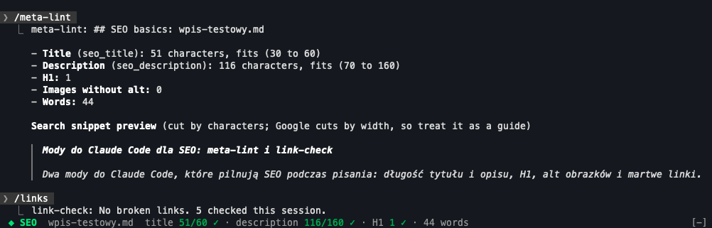

# Claude Code mods by krysmalskipl

Mods for [Claude Code](https://claude.com/claude-code), built for SEO and content work. Install only the ones you want.

## Install

Every mod installs on its own. The quick version:

```sh
claude plugin marketplace add krysmalskipl/claude-code-mods
claude plugin install <mod>@krysmalskipl
```

Then restart Claude Code. Each mod below has the full steps, including any key it needs.

Needs Claude Code 2.1.287+ in the terminal, or the Claude desktop app's Code tab. Plugins installed from the terminal show up in both.

## Mods

| | Mod | What it does | Command |
| --- | --- | --- | --- |
| 🪙 | **openrouter-balance** | Your OpenRouter credit: the real balance with a gauge, today's spend and the model the money mostly went to. A regular API key shows its own spend and limit instead | `/openrouter-balance` |
| 📏 | **meta-lint** | The SEO basics of the page or post Claude just edited: title and meta description length, H1 count, images without alt, word count. Markdown, MDX, Astro and HTML | `/meta-lint [file]` |
| 🔗 | **link-check** | Checks the external links Claude adds. Broken ones go back to Claude so it can fix them, and show above the prompt | `/links [file]` |
| 🪧 | **share-preview** | How the page looks in Google (desktop and mobile, cut by pixel width) and as a shared link on LinkedIn, Facebook, Slack and X, with what would cost you clicks. Live while Claude edits | `/preview [url \| file]` |
| ⏱️ | **cache-stats** | Your prompt cache above the prompt: hit rate, how long it stays warm, what a cold restart re-caches, and how long the session has run. `/cache` lists every miss and why | `/cache [hide\|show]` |

### 📏 meta-lint



One line above the prompt after Claude edits a page or post:

```text
◆ SEO  post.md  title 58/60 ✓ · description 186/160 ✗ · H1 1 ✓ · 2 images without alt · 2,726 words
```

#### Install

```sh
claude plugin marketplace add krysmalskipl/claude-code-mods   # once per machine
claude plugin install meta-lint@krysmalskipl
```

Restart Claude Code or type `/reload-plugins`. No key, no setup: it reads files on your machine and sends nothing anywhere. The line appears after Claude's first `Write` or `Edit` of a `.md`, `.mdx`, `.markdown`, `.astro`, `.html` or `.htm` file.

#### What it checks

| Check | Where it looks | Green | Yellow | Red |
| --- | --- | --- | --- | --- |
| **Title** | Frontmatter `seo_title`, `meta_title` or `title` (the first one set), else `<title>`, else the first `# H1` | 30 to 60 characters | under 30 | over 60, or missing |
| **Description** | Frontmatter `seo_description`, `meta_description`, `description` or `excerpt`, else `<meta name="description">` | 70 to 160 characters | under 70 | over 160, or missing |
| **H1** | `# ` lines and `<h1>` tags in the body, outside code blocks | one, or none when the frontmatter has a `title` (templates usually render it as the H1) | | more than one, or none at all |
| **Images without alt** | `` and `` without `alt` | | | any |
| **Words** | the body, without code | shown, not judged | | |

#### Commands

- `/meta-lint` shows the details of the last page: each value, where it came from, how far over or under it is, and a search snippet preview cut where Google would likely cut it
- `/meta-lint path/to/file.md` checks any file, edited or not

Limits are in characters. Google cuts titles by pixel width (about 600 px), so a title of wide letters can be cut sooner: treat the numbers as a guide.

### 🔗 link-check

Checks every external link Claude adds to a page, post or template, while Claude is still working.

```text
◆ Links  2 not working · https://gone.dev/page (404) in post.md and 1 more · /links
```

#### Install

```sh
claude plugin marketplace add krysmalskipl/claude-code-mods   # once per machine
claude plugin install link-check@krysmalskipl
```

Restart Claude Code or type `/reload-plugins`. No key, no setup.

#### How it works

- After each `Write` or `Edit` of a `.md`, `.mdx`, `.astro`, `.html`, `.tsx`, `.jsx`, `.vue`, `.svelte`, `.php`, `.njk`, `.liquid` or `.twig` file, it finds the `http(s)` links **new in that edit** and asks each one (a `HEAD`, or a `GET` when the host refuses `HEAD`)
- **Claude is told**: links that answer 4xx or 5xx, or don't answer at all, go back to Claude with the edit's result, so it can fix or remove them in the same turn
- **You see them** above the prompt until they're gone from the file. `/links` lists them
- An edit waits at most 6 seconds for its links. A slower host's answer comes later as a toast
- 401, 403 and 429 count as working: they're usually bot walls or rate limits, and the page opens in a browser
- Skipped: `localhost`, `127.0.0.1`, `example.com`, `.local`, `.test` and links with template placeholders (`${…}`, `{{…}}`)
- Each URL is asked once per session, at most 25 per edit and 6 at a time. Requests go from your machine straight to each link's host, nowhere else

#### Commands

- `/links` lists the links that don't work, and where
- `/links path/to/file.md` checks every link in a file now (up to 100), with ✓ working, ↪ redirect, ~ blocks bots and ✗ broken

### 🪧 share-preview

See the page you're building the way people will meet it: as a Google result and as a link someone shares. A pane next to the chat, updated while Claude edits.

```text
✗ og:image "/og.png" is relative: platforms need a full https:// URL
! Title is 668px wide, Google shows about 600px: the end is cut
! No twitter:card: X shows a small thumbnail, add summary_large_image for the big card
✓ Description fits desktop and mobile (512px)
```

#### Install

```sh
claude plugin marketplace add krysmalskipl/claude-code-mods   # once per machine
claude plugin install share-preview@krysmalskipl
```

Restart Claude Code or type `/reload-plugins`. No key, no setup.

#### Use it

- `/preview` shows the page Claude edited last: HTML, Astro, Vue, Svelte, JSX with `<Head>`, a Next.js `metadata` export or Markdown frontmatter. The pane follows every later edit of that file
- `/preview localhost:3000/pricing` reads the page your dev server renders, the most accurate view. It refreshes after each of Claude's turns
- `/preview https://example.com` checks a live page
- In the pane: `g` Google, `s` shared link, `r` refresh

#### What it shows

- **Google**: the desktop and mobile result, the title cut at about 600 px and the description at about 920 px (desktop) and 680 px (mobile), measured in Arial glyph widths the way Google draws them, not in characters
- **Shared link**: the LinkedIn and Facebook card, Slack's unfurl and X's card (large, small or none, from `twitter:card`), with the fallbacks each platform uses when a tag is missing
- **Checks**, worst first: `noindex`, a missing title, a missing or relative or local `og:image`, an `og:image` that doesn't load (it asks the URL, or looks in `public/` and `static/` for a local file), a `canonical` pointing at localhost, titles and descriptions too long or too short, a missing `twitter:card`, `og:image:alt` or `<html lang>`
- Tags set in code (`{post.title}`, `generateMetadata`) are marked as such: `/preview <url>` reads them rendered

The findings also go to Claude as context, so "fix these" just works. Pages and images are fetched from your machine; nothing is sent anywhere else.

Google publishes no snippet limits: the pixel widths are the ones SEO tools have measured for years. Treat them as a close guide, not a promise.

### ⏱️ cache-stats

Claude Code resends the whole conversation with every request, and the prompt cache is what keeps that cheap and fast. This shows what the cache is doing, live.

```text
◆ Cache  █████████░ 96% hit · warm 3m · 133k cached · session 1h 12m (23m working) · avg 94% · 38 requests
◆ Cache  ░░░░░░░░░░ 0% hit · cold, next message re-caches 133k · session 2h 05m (31m working)
```

#### Install

```sh
claude plugin marketplace add krysmalskipl/claude-code-mods   # once per machine
claude plugin install cache-stats@krysmalskipl
```

Restart Claude Code or type `/reload-plugins`. The line appears after Claude's first reply. It reads Claude Code's own usage figures and sends nothing anywhere.

#### Set the cache lifetime

The hit rate is measured, but the **warm** countdown needs to know how long your cache lives: **5m** on an API key, usually **1h** on a Claude subscription. The default is 5m. Change it in `/config` → cache-stats, or from a shell:

```sh
echo '{"ttl":"1h"}' | claude plugin configure cache-stats@krysmalskipl --values-stdin
```

#### What the line shows

- **Hit rate** of the last request: how much of the prompt the cache served. Green from 80%, yellow from 50%, red under
- **Warm 3m**: time left before the cache lapses, counted from the last reply. Once it has, the line says what the next message re-caches
- **Cached**: tokens in the cache now, the size of the last prompt
- **Session** time since the session started, and how much of it the model spent working
- **avg** and **requests**: the hit rate over the whole session and the number of requests to the model

On a narrow terminal the right-hand parts drop out first.

#### Commands

- `/cache` shows the details: state, session totals (read from cache, written, sent uncached, generated), every **miss** with the reason, and the last requests
- `/cache hide` and `/cache show` take the line away and bring it back

A miss is a large prompt (5,000+ tokens) the cache mostly did not serve. The reason is told by the gap before it: **idle longer than the cache lives** means it simply expired; **soon after the last request** means something under the cache changed, such as `/model`, `/compact`, an edited `CLAUDE.md` or a new MCP tool. That second kind is the one worth hunting down, since each costs a full re-cache.

Subagents run on caches of their own and are not counted.

### 🪙 openrouter-balance


Your OpenRouter credit in one line above the prompt, refreshed every 5 minutes and after each turn.

#### 1. Check your Claude Code version

```sh
claude --version
```

You need 2.1.287 or newer. Older? Update with `claude update` (or `npm install -g @anthropic-ai/claude-code`). In the desktop app, type `/status` in a Code tab session.

#### 2. Add this marketplace

Once per machine, in a terminal:

```sh
claude plugin marketplace add krysmalskipl/claude-code-mods
```

Or inside a Claude Code session: `/plugin marketplace add krysmalskipl/claude-code-mods`.

#### 3. Install the mod

```sh
claude plugin install openrouter-balance@krysmalskipl
```

Or inside a session: `/plugin install openrouter-balance@krysmalskipl`.

It ends with "1 userConfig option not yet set". That's the optional key from step 4. If your key is already in your environment or Keychain, ignore it.

#### 4. Give it an OpenRouter key

Pick the kind of key first:

| Key | What the line shows | Where to make one |
| --- | --- | --- |
| **Management key** (recommended) | The account's real balance, today's spend and the model the money mostly went to | [openrouter.ai/settings/management-keys](https://openrouter.ai/settings/management-keys). It can't call models, so it's safe to keep around |
| **Regular API key** | Only that key's own spend today and this month, and what its limit leaves | [openrouter.ai/settings/keys](https://openrouter.ai/settings/keys). The `OPENROUTER_API_KEY` you already use works |

Then put it in one place. The mod looks in this order and takes the first it finds:

1. **`/config` → openrouter-balance** in an interactive `claude` terminal session, or from a shell:

   ```sh
   echo '{"apiKey":"sk-or-v1-..."}' | claude plugin configure openrouter-balance@krysmalskipl --values-stdin
   ```

   That line lands in your shell history; the Keychain (3) keeps the key out of it.

2. **An environment variable**: `OPENROUTER_MANAGEMENT_KEY` for a management key, `OPENROUTER_API_KEY` for a regular one. Add it to `~/.zshrc` (or your shell's startup file):

   ```sh
   export OPENROUTER_MANAGEMENT_KEY="sk-or-v1-..."
   ```

3. **The macOS Keychain** (no key in any file). Paste the key when asked:

   ```sh
   security add-generic-password -a "$USER" -s openrouter-key -w
   ```

4. **Your login shell**: when Claude Code doesn't see the variables itself (the desktop app started from the Dock never reads `~/.zshrc`), the mod asks your shell for `OPENROUTER_MANAGEMENT_KEY` and `OPENROUTER_API_KEY`. So a key exported in `~/.zshrc` works there too.

The key is kept in memory only and sent only to openrouter.ai.

#### 5. Restart and check

Start a new Claude Code session (or type `/reload-plugins` in an open one). Within a few seconds a line appears above the prompt:

```text
◆ OpenRouter  █████████▁ $2.67 of $3.00 key limit left · $0.33 today
```

Type `/openrouter-balance` for the breakdown: balance, today, yesterday, last 30 days and spend, requests and tokens by model. With a regular key: today, this week, this month, all time, its limit and budget.

#### Update or remove

```sh
claude plugin marketplace update krysmalskipl
claude plugin update openrouter-balance@krysmalskipl

claude plugin uninstall openrouter-balance@krysmalskipl
```

#### If something's off

| The line says | Why | Fix |
| --- | --- | --- |
| Nothing at all | The mod isn't loaded yet | Start a new session, or `/reload-plugins`. Check `claude plugin list` shows it enabled |
| `no key set` | No key in any of the four places | Step 4. In the desktop app, the Keychain is the surest place |
| `key rejected` | The key was revoked or disabled | Make a new one, put it where the old one was |
| `can't reach OpenRouter yet` | No network, or OpenRouter is down | It retries every minute by itself |
| `$0.42 today · $12.30 this month` and no balance | A regular key with no limit: it can't see the account | Use a management key for the balance, or set a limit on the key |
| `… · offline` | The last refresh failed | The numbers are the last good ones; it retries every minute |

#### How it counts

- Green from $5, yellow under $5, red under $2
- "Today" is the UTC day. With a management key it's the usage now minus where it stood when the mod first saw the day; a day first seen after 00:15 UTC shows "since HH:MM" (UTC)
- Spend by model comes from OpenRouter's `/activity`, which holds completed UTC days only

## Develop

```sh
claude plugin validate mods/<name>
CLAUDE_CONFIG_DIR=$(mktemp -d) claude plugin test mods/<name>
```

More mods: [hamzafer/claude-code-mods](https://github.com/hamzafer/claude-code-mods).

## License

MIT
